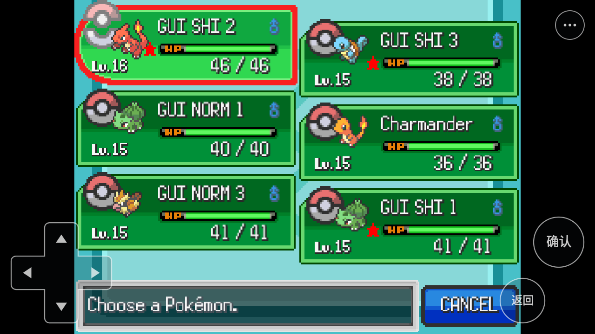
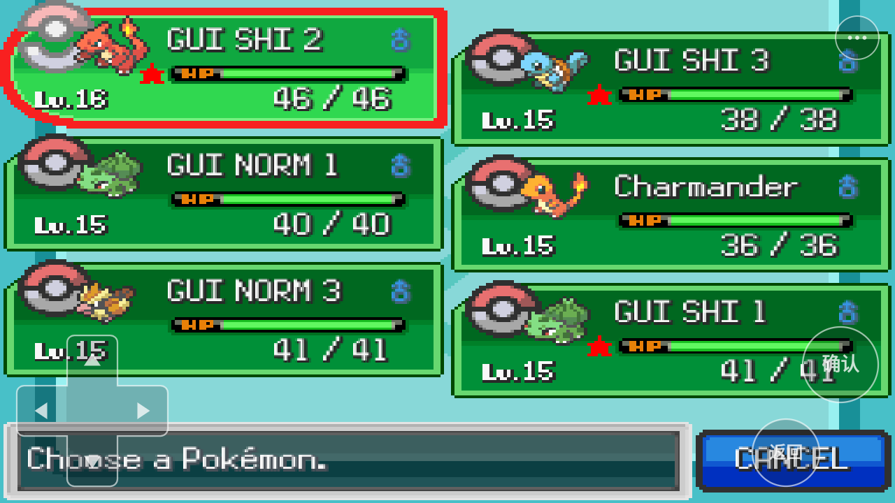
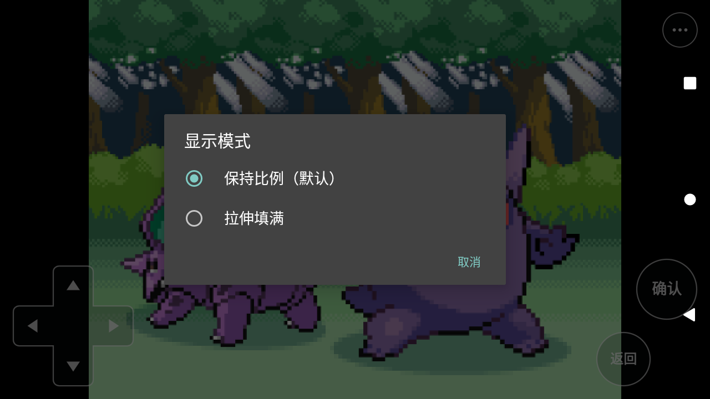

# Android.8 显示模式回归

日期：2026-10-21。已实现、已构建并在原 API30 模拟器运行验证。开发分支 `codex/android-port-v1`，未合并 dev/main，未公开发布，普通 ARM64 手机包未真机验收。

## 构建与环境

版本 `0.20.7-android.8` / code 8，包名 `org.kuray.kif`。两个 APK 各 742,775,021 字节，payload `bfbb9a9a05db91abab51e7f2`；完整 SHA256 和复现命令见 [发布说明](release-notes-android8.md)。JNI 桥已从本版源码重建；游戏 core 沿用固定上游预编译库。

设备为原 `emulator-5554` / `kif_api30`，Android 11 / API30，x86_64 上的 ARM64 翻译，3 GiB RAM，240 dpi，横屏 1280×720，4 KiB 页。仍为原 6 GiB 数据盘；没有新建、扩容或清理素材。源码运行时接入、真机、刘海和其他系统矩阵不属于本轮结论。

证据全部位于 `temp/evidence/display8/`，操作脚本与自动审计为 `temp/display8/device.py`、`finalize.py`。截图为未修改的 ADB 原图。`084-summary.json` 汇总截图边界、单选状态、存档和构建来源核验。

## 安装和数据保护

`000-before-upgrade.tar/json` 保存原 31 个 QA 存档/备份文件，全部与 Android.7 最终检查点一致。原按键大小为 100%，没有显示模式偏好文件。

直接 `adb install -r` 返回 `INSTALL_FAILED_INSUFFICIENT_STORAGE`，仍保留 Android.7；不计为升级通过。随后使用 Android 包管理器 `cmd package uninstall -k org.kuray.kif` 保留应用数据，再安装同测试签名的 .8，返回 Success。ADB 的普通 `uninstall -k` 提示改用上述 package 命令，没有执行删除数据。只读 `du` 统计因目录遍历缓慢被终止，没有修改文件。

`007-after-install`、`068-after-modes`、`078-final-saves` 的 31 文件清单与基线逐路径 SHA256 完全相同，未增加、改写或删除任何存档。按键偏好仍是 `button_scale=1.0`。原下载、修改图片、缓存及旧资源均由保留数据安装路径继续保留；安装器完成新素材验证并正常迁移上一版图片。没有 Windows 玩家存档操作。

## 实际游戏验证

| 场景 | 实际结果与证据 |
| --- | --- |
| 无既有显示偏好 | `017` 确认偏好文件不存在，启动配置 `fixedAspectRatio=true`；`021/022` 单选默认保持比例 |
| 保持比例 | `026` File E 读档菜单、`029/062` Route1 地图、`034` 队伍完整显示，画面为 x160–1119、y0–719，即 960×720 |
| 保持比例下的按键 | `032–034` 虚拟返回打开暂停菜单，方向下移到 Pokémon，确认打开六只队伍；`063/064` 稳定地图长按下 900ms 可见移动，松手后停止 |
| 即时拉伸 | 在同一队伍界面从 `036` 点选拉伸，`037` 直接变为 x0–1279、y0–719，即 1280×720；全部六只、等级、HP、闪光标记和取消区域仍完整 |
| 拉伸下的按键 | `038` 虚拟右键从第1只选到第2只，`039` 确认打开 Summary/Switch/Item/Nickname/Cancel，`040` 返回关闭；`041/042` 两次返回到地图；`043/044` 长按下 900ms 移动后停止 |
| 按键几何 | 两模式方向键、确认、返回和菜单位置及形状一致，圆形按钮没有跟随游戏横向拉伸，大小设置保持100%；实际点击坐标一致 |
| 拉伸热恢复 | `046` Home 后重开应用，仍为原游戏 PID5437，地图保留拉伸；这是一次热恢复，未宣称锁屏/长后台/音频矩阵通过 |
| 拉伸冷启动 | force-stop 后新 PID6092；`049` 偏好 true、启动配置 fixedAspectRatio=false；`050` 加载画面与 `057` File E 读档菜单均1280×720；`052/053` 拉伸单选保持，取消不改变 |
| 切回保持比例 | `059/060` 在读档菜单即时切回，恢复960×720；确认读E后 `062` 地图仍960×720 |
| 保持比例冷启动 | force-stop 后新 PID6434；`067` 偏好 false、配置 fixedAspectRatio=true；`069` 加载画面、`075` 实际标题保持960×720；`071/072` 默认项选中，取消不改变 |

最初 `030` 的400ms地图手势未观察到位移，不以它作为移动通过证据；后续稳定地图两模式的900ms手势均可见一格左右的相机/场景位移。未测量触控响应时延或最短移动按压阈值。标题/读档加载和淡入时的黑帧保留在原证据中，不作为画面尺寸检查样本。

以下是同一队伍界面的即时切换，人物横向变宽属于拉伸模式预期行为：

## 自动核验与边界

- 12 张实际截图在未被顶部工具按钮覆盖的第100行检测边界：7张保持比例为 `[160,0,1120,720]`，5张拉伸为 `[0,0,1280,720]`，右边界不含。完整截图同时人工确认没有裁切 UI 内容。
- `022/053/072` 的真实 UI XML 单选状态依次为0、1、0。最终偏好 false，mkxp 配置 true，按键大小1.0。
- 同一队伍静态区域 `(250,210)–(500,350)`，将4:3内容仅横向放大到1280后，与实际拉伸截图的RGB平均误差约2.79/2.71/2.40（0–255），符合像素采样差异；这是该静态区域核验，非全图逐像素相等结论。
- .8 已安装目标类重新通过20个真实 Android MotionEvent案例、197断言，0失败；包括多指、换向、拖离、取消和尺寸边界。组件结果为 `008-touch-result.json`，与游戏操作分开记录。
- 主机全套检查通过，含10项新显示模式契约、平台62、输入69、文本188、选槽35、文件/ZIP事务33以及444个Ruby文件编译。不是设备玩法验收。
- 两个 APK 的构建记录均通过源码快照及 staged Ruby 校验，收口审计再次对照本版源码 SHA。没有修改已交付 APK 的构建记录来冒充游戏全量通过。

最终整个包已 force-stop，Launcher 与 `:game` PID 均为空；31文件与基线相同。没有进行游戏内保存。没有重跑战斗、捕捉、融合、拆分、文本输入和SAF全量矩阵，不把历史版本结果计入 .8。日志保留既有下载写入失败诊断及模拟器系统存储告警，本轮没有对网络或容量治理给出通过结论。
