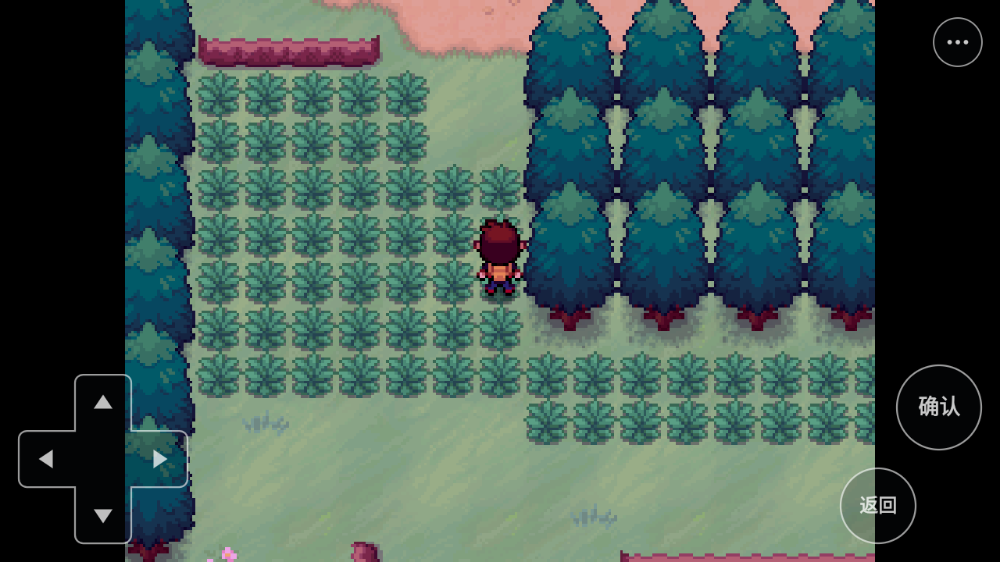
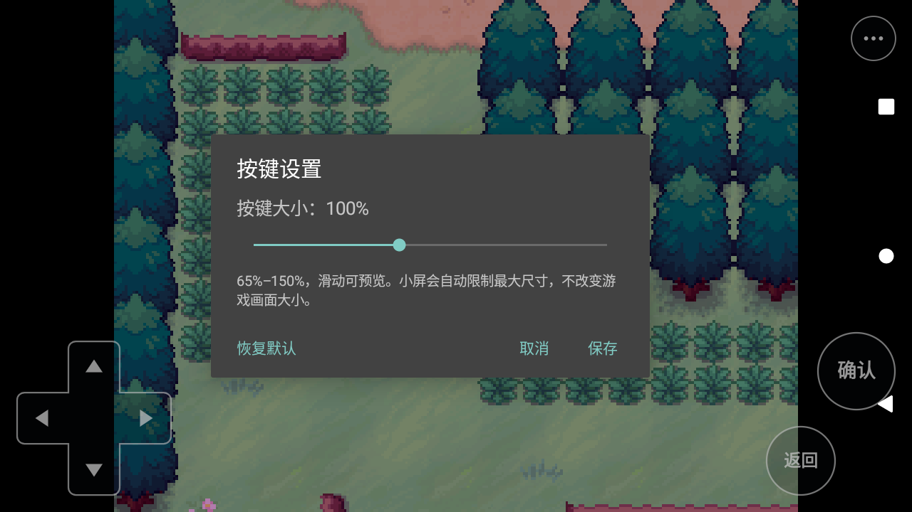

# 半透明虚拟按键与大小设置

适用源码：Android.7，提交`c4421270`。本文区分实现说明、主机检查、组件触控和真实游戏操作；实际范围见[本版设备报告](android7-device-report.md)。

Android.8 延续本页按键行为，并在「⋯ → 显示模式」加入默认保持比例 / 拉伸填满，即时生效并记住选择，详见[显示模式说明](display-modes.md)及[Android.8设备报告](android8-device-report.md)。下列设备结果保留为 Android.7 历史验收。

## 使用方法

- 左下方向键用于移动和菜单选择；右下「确认」相当于游戏原来的 C，「返回」相当于 X。
- 右上角「⋯」展开不常用操作：跑步 Z、A、S、快捷 D、Q、W、键盘、存档 / 退出。再次点击「⋯」或按 Android 返回键收起工具。
- 进入「⋯ → 按键设置」，拖动「按键大小」滑块，在 **65%–150%** 间预览方向键、确认和返回的大小，默认 100%。点击「保存」后，下次启动继续使用该设置。
- 「取消」、Android 返回键或关闭对话框会还原本次调整前的大小。「恢复默认」只把预览改为 100%，再点「保存」才持久保留。
- 小屏会进一步限制实际尺寸，避免左右操作区相互重叠。菜单入口保持 48 dp，弹出的快捷按钮保持固定尺寸；滑块不改变游戏画面或素材分辨率。
- 输入昵称、备份名等文字时，在游戏已进入文本字段后，使用「⋯ → 键盘」。Android 返回键先隐藏软键盘，再用游戏「确认」提交或「返回」取消。
- 「存档 / 退出」打开关闭确认。先在游戏内保存，再确认关闭，回到管理页导入或导出存档。

按键底色约 20% 不透明，轮廓和文字更清晰；按下时会提高亮度。没有不透明的常驻左右按钮栏。游戏仍保留原来的 **512×384、4:3** 比例，等比占满可用高度或宽度；宽屏上的余边属于比例差异，不会拉伸或裁掉剧情、地图和菜单。

以下为Android.7在API30模拟器的原始运行截图：

## 实现位置与边界

| 部分 | 源码 | 行为 |
| --- | --- | --- |
| 绘制和命中 | `android/app/src/main/java/org/kuray/kif/TouchControlsView.java` | Canvas 绘制半透明方向键、确认、返回和菜单入口；画面边缘布局不预留 Surface 宽度 |
| 多点输入 | 同上 | 按 pointer ID 跟踪手指；方向键可滑动换向；同键用引用计数，仅首个按下和最后释放发送状态 |
| 设置和工具菜单 | `android/app/src/main/java/org/kuray/kif/GameActivity.java` | `⋯` 展开工具；滑块实时预览；保存、取消及恢复默认 |
| 持久化 | 同上 | 私有 `SharedPreferences`：文件 `touch_controls`，键 `button_scale`；与游戏存档和存档 ZIP 分开 |
| 释放输入 | 以上两个 Java 文件 | 取消手势、菜单接管、失焦、后台、布局变化或 View 销毁时释放，防止持续移动或确认 |
| 游戏键位 | `GameActivity.java` → `NetworkBridge` → `kif_android_input.rb` | 保留既有 JNI 队列和 RGSS Input 映射，没有重写剧情、战斗或菜单处理 |
| 显示策略 | `Data/Scripts/000_Platform.rb`、`001_Technical/001_MKXP_Compatibility.rb` | Android 的 `screen_resize_factor` 强制使用全屏分支；Windows 保留原来缩放分支；不改写导入存档里的桌面设置 |

`mSurface` 不再有左右 112 dp 的固定边距。窗口使用沉浸式显示，临时系统栏覆盖在画面之上；刘海安全区同时作用于游戏和按键。原有 `fixedAspectRatio:true` 保留。软键盘仍使用 `adjustNothing`，避免通过键盘高度缩放 RGSS 画面。

本版没有任意拖动按键、自定义透明度、单独缩放每个按钮、振动反馈或游戏界面触屏重设计。A/S/D/Q/W 仍为原有快捷键，具体作用取决于当前游戏场景。

## 已完成的主机检查

以下均为模拟本地原生接口的检查，不是模拟器游玩结果：

- 平台契约 **62 个断言通过**：执行真实 `pbSetResizeFactor`，覆盖 Android 与 Windows 的 `-1、0–4` 档，以及重复调用；Android 不进入窗口缩放和居中，Windows 保留原行为。
- **444 个 Ruby 文件编译通过**；桌面键位启动 9、读档槽位 35、标题输入 24 个相关断言通过。
- Java 静态审查未发现需要阻断构建的多指引用、取消还原或菜单释放问题。点击、尺寸持久化和系统行为仍需下面的实际验收。

## 模拟器与真机验收清单

| 场景 | 预期 | 本文状态 |
| --- | --- | --- |
| 标题首次确认 | 一次正常点击通过标题，不需要重复按键 | API30实际通过，包含默认和150% |
| 默认布局 | 仅方向、确认、返回和 ⋯ 常驻；没有固定按钮栏；4:3 内容完整 | API30实际960×720，宽屏有保比例余边 |
| 65% / 100% / 150% | 绘制与点击位置一致；主画面大小不变；按钮不重叠 | 实际滑块/预览/65%菜单队伍操作通过；7张截图边界均960×720 |
| 设置保存并冷启动 | 关闭进程后重启，已保存大小保留 | 实际150%保存后force-stop重启保留；100%默认保存后SAF冷启保留 |
| 取消与恢复默认 | 取消还原旧值；恢复默认再保存为 100% | 实际150%预览取消回65%，恢复默认100%并保存通过 |
| 多点按下与释放 | 方向与确认/返回、展开的快捷键可以组合；同键两个手指先松一个仍保持，最后松开才释放 | 真实MotionEvent目标View组件通过；展开快捷键与方向的整游戏组合待补 |
| 方向滑动 / 拖离 | 滑动正确换向；越界或取消后停止；没有卡键 | 组件覆盖换向/拖离/CANCEL；实际地图按住700ms移动后释放停止 |
| 菜单 / 对话框接管 | 打开工具、设置和关闭确认时释放移动；关闭后下一次输入正常 | 实际菜单、尺寸设置、取消和退出管理正常；按住接管以组件释放案例为证 |
| 文本输入 | 键盘输入 → Android 返回隐藏 → ⋯ 重开 → 继续输入 → 确认保存；另测返回取消 | 实际Gboard r→隐藏→重开→z=rz，确认及同名备份保存通过；文本取消本版未重跑 |
| 后台与系统栏 | 按住时切后台、锁屏或显示系统栏，恢复后无卡键，沉浸式与比例恢复 | 一次Home热恢复正常；按住/锁屏/音频待补 |
| SAF 后第一次冷启 | 真实系统文件选择器导入/导出返回后，首次启动就保持最大 4:3 画面 | 实际导出后第一次标题及读E均960×720；只对当前API30成立 |
| 地图、战斗、仓库、保存读档 | 悬浮按钮可操作原界面；文字、选择项与角色等关键内容可辨认 | .7移动/队伍/PC满箱浏览/命名备份/保存/冷读通过；战斗/融合未本版全量重跑 |
| 不同设备 | 宽屏、刘海、不同密度和较小屏幕安全区正确 | 待补真机和其他模拟器配置 |

实际回归应记录 APK 摘要、设备/系统/屏幕密度、每一步操作、预期与结果，并保留截图及日志。使用本地人工 QA 档，不覆盖 Windows 玩家存档；改变前后核验非测试存档哈希。

组件测试脚本为`scripts/android/run_touch_checks.py --run --serial emulator-5554 --expect-version 0.20.7-android.7`，本轮20/20案例、197断言。它加载已安装目标类，在Android主线程执行真实MotionEvent，不启动游戏、不读写存档。1280×720/1920×1080/640×360是组件layout尺寸，不能当作三台设备或全游戏屏幕矩阵。

## 参考设计

布局沿用成熟模拟器的半透明悬浮控件、按下反馈和缩放设置做法，保留 KIF 的原有键位语义：

- [PPSSPP 控制设置](https://www.ppsspp.org/docs/settings/controls/)
- [RetroArch 悬浮控件文档](https://docs.libretro.com/development/retroarch/input/overlay/)

这些是交互参考，并非引入对应播放器或复制其皮肤；最终游戏仍由本项目独立 APK 启动。
