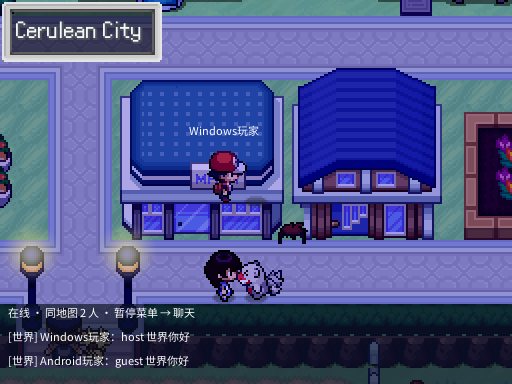
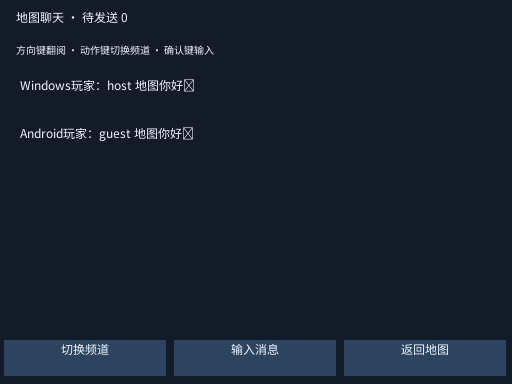
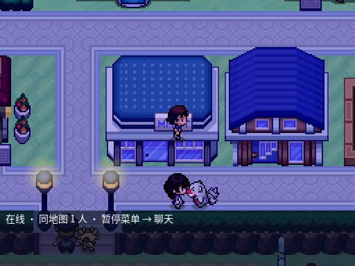
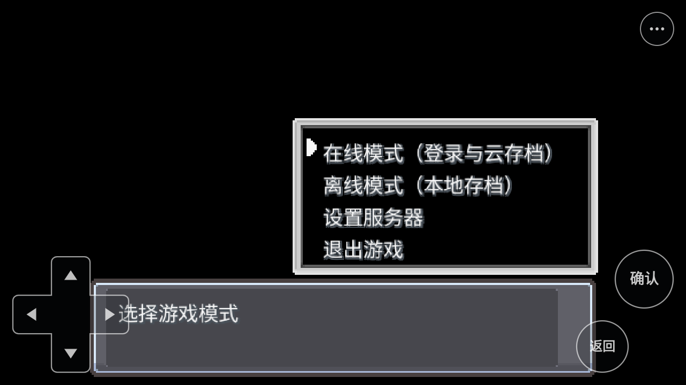

# Android.9 与 Windows 同服验收

验收日期：2026-10-22（Asia/Shanghai）。分支：`codex/overworld-chat`。

## 结果

完整游戏联测通过，证据见 [result.json](multiplayer-validation/android9/result.json)。运行 Windows `Game.exe`（Ruby 3.1.3）和 Android.9 完整 APK（Ruby 3.4.10），共启动五个独立游戏进程。客户端通过同一个本地测试服务通信，没有伪造服务器响应、地图指纹、角色对象或云存档内容。

| 检查项 | 结果 |
| --- | --- |
| 启动模式选择、注册、再次登录，在角色流程前完成认证 | 通过 |
| 在线/离线存档目录隔离 | 通过 |
| 同地图真实远端玩家精灵与名字显示 | 两端通过 |
| Windows 移动与朝向传到 Android | 通过 |
| 地图与世界聊天，中文及 Unicode 数据传输 | 两端通过 |
| 切图后移除玩家，地图消息不外泄，世界消息跨图送达 | 通过 |
| 手动保存到服务器 | 两端通过 |
| 等待真实 60 秒周期，自动保存到服务器 | 两端通过，没有修改计时器 |
| Windows 创建角色 → Android 空缓存恢复 | 通过 |
| Android 继续该角色、修改后上传 → Windows 空缓存恢复 | 通过 |
| Android 创建角色 → Windows 空缓存恢复 | 通过 |

恢复断言涵盖角色名、宝可梦及昵称、7 个伤药、剧情开关和变量、定时保存后的进度。Windows 往返恢复还验证了 Android 修改的昵称“安卓接力”及变量 45 的值 9090。服务端最终保留两个账号的 `file-a` 存档，修订号分别为 4、7。

另外以 APK 常规入口启动（没有 customScript），使用 Android 虚拟确认键依次验证标题 → 在线/离线模式选择 → 登录/注册菜单，角色流程前的界面门禁正常。

### 游戏画面

## APK

文件位于仓库 `temp/artifacts/`，均为本地开发签名测试包，versionCode 9，Android 11/API 30 起，ARM64：

- 手机包：`KIF-0.20.7-android.9-arm64-network-test.apk`，750151984 字节，SHA256 `954d973071e7aadf7a652bb3f70c3dcb67145fe3d41ae58c43229f165ec28605`。
- 模拟器包：`KIF-0.20.7-android.9-arm64-emulator-network-test.apk`，750151984 字节，SHA256 `cfd952f70179a5d8d6ff8c6649646b7abc610bffe6dc44e53689082a45c114d0`。

两个包游戏资源完全相同，payload ID 为 `d787e2264c8f5de6604ba8ff`。兼容性数据哈希为 `03fb6f554e8c4abb041ae9221846a9932caed912bc216dd864e1fb325f64475c`。已核对设备安装的 APK SHA256 与本次模拟器产物一致。

手机包使用原始固定哈希运行库；模拟器包使用单独记录来源的旧 ARM 转译兼容版本。不要把模拟器版本作为手机验收包。两个包都包含异步 HTTPS 桥接版本 1、INTERNET 权限、Android.8 的触控/输入/字体/显示适配。没有放宽 HTTPS 证书或主机名校验。

构建来源、运行库哈希和异步桥接版本见同目录两个 `*-summary.json`；完整构建记录和 `.sha256` 文件保存在 `temp/artifacts/`。

## 范围与限制

- 本次 Android 设备是独立 Android 11 x86_64 模拟器，通过 ARM64 转译运行完整游戏；未连接实体手机，实体 ARM64 性能及兼容性仍需实机验证。
- UI 选择和密码输入使用测试夹具，调用生产模式选择、账号与云存档流程；原生地图、精灵及聊天界面真实渲染。该测试不等于逐一手工验证所有触控/输入法操作。
- 同服联测使用数字 IP 的本地开发 HTTP 地址（Windows `127.0.0.1:18801`，Android `10.0.2.2:18801`）。正式部署应配置自己的 HTTPS 服务；账号库和存档库不会随 APK 分发。
- 中文显示正常。测试表情的 Unicode 数据完整传达，但当前字体可能显示为方框。
- 全新测试模拟器曾出现 Pixel Launcher/System UI 的系统 ANR；关闭该系统弹窗后完成联测。此前失败未计为通过，没有改变游戏网络超时或安全校验来绕过问题。
- 客户端启动脚本只临时替换隔离模拟器的诊断入口，退出后恢复；账号和存档位于独立测试目录。没有使用或迁移玩家原有存档。

## 修复和检查

本阶段整合较新的 Android.8 外壳，避免 Android.9 回退已有触控和显示能力；补齐输入法确认同帧末尾字符处理、虚拟输入安装、安卓键位初始化守卫、资源路径与下载写入处理。保留了匿名统计设置入口及已有偏好。构建器分离手机/模拟器目录，拒绝过期脚本与桥接，记录源文件哈希并验证签名。

检查结果：服务端 157 项、在线账号/安全存档 21 项、Android 联网适配 16 项、APK 资源/构建 11 项测试通过。输入法桥接 188 项、输入桥接 69 项、位图路径 11 项、显示模式 10 项断言通过；Java 异步 HTTP 队列 218 项、存档转移 33 项及 Ruby 全量语法检查通过。

此前独立 Android HTTPS 压测已验证 4 秒慢请求仍持续更新 Graphics/Input、超时与取消、并行请求及拒绝不可信证书。该记录与本次完整游戏 HTTP 同服验收分别保留，不能将后者表述为生产 HTTPS 服务上线验收。

## 复现

1. 先运行 `scripts/multiplayer/build.py --check`。若主动修改游戏源文件，重新生成兼容性清单、用真实引擎导出服务端目录，再刷新 APK 资源。
2. `scripts/android/build_apk.py --with-network` 构建手机包；另加 `--emulator-compatible` 构建模拟器包。需要已准备的 SDK/JDK、固定运行库、源码构建的异步 JNI 桥接。
3. 在名称以 `kif_mixed_` 开头的自有隔离 AVD、端口 5556 上安装模拟器包，启动 Launcher 并传 `manageSaves=true`，等待完整内容安装结束。
4. 运行 `scripts/multiplayer/run-mixed-world-test.py --serial emulator-5556 --timeout 300`。脚本拒绝操作已有的 `emulator-5554`，核验 APK/内容哈希，启动隔离 SQLite 服务和五个游戏进程，最后还原诊断入口并停止服务。

`customScript` 会跳过 mkxp 的常规 preload 路径，因此测试入口显式加载 APK 自带 `kif_android_preload.rb`。生产正常启动仍使用配置中的 preload。测试协调路由仅存在于测试服务子类，不属于生产服务 API。
