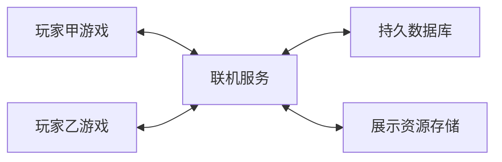

# Kuray Infinite Fusion 联机功能需求说明 草案

版本：0.1  
日期：2026 年 10 月 16 日  
适用项目：Kuray Infinite Fusion 当前仓库  
用途：明确联机玩法、玩家流程、异常处理和分期验收，供功能讨论及开发拆分使用。

建议以“好友房间、精灵展示、好友单打”为首版，再加入双人 Boss、异步玩家道馆和交换，最后扩展租借杯、可走动大厅和独立合作副本。下文的新增功能均为拟定需求；人数、时限和战斗规则是建议默认值，尚未表示已实现或经过容量验证。

# 项目现状和可复用基础

| 能力 | 当前源码情况 | 对联机开发的意义 |
| --- | --- | --- |
| HTTP 请求和 JSON 处理 | 已有 HTTPLite 调用，用于素材及数据请求 | 可用于连通检查、展示、道馆、交换等接口；实时战斗消息仍需单独设计 |
| 素材与图鉴下载 | 设置中已有 Download data 开关和外部网址 | 继续作为现有下载功能维护，与玩家联机开关分开 |
| 普通奇迹交换 | Wondertrade 脚本明确为离线随机模拟 | 保留原玩法；新增在线入口必须清楚标明区别 |
| 在线奇迹交换 | OnlineWondertrade 已有发送资料和处理返回结果的客户端原型，默认地址为 localhost:8080 | 当前原型不能直接作为完整联机功能交付；仓库未附对应服务端，可读脚本中未检出调用入口 |
| 精灵个体资料 | 已有物种、招式、IV、EV、双特性和自定义闪光等读写字段 | 可参考字段定义，建立独立网络数据格式 |
| 战斗模式 | 已有单打、双打、2v1 和多训练师队伍基础 | 可扩展好友对战和双人 Boss，仍需远端控制与统一结算 |
| 战斗记录 | 已有指令和随机结果记录及回放代码 | 可作为回合记录、重连和后续回放的参考，改版机制需逐项验证 |
| 合作副本 | KurayRogue 文件为空，箱子相关代码不是完整副本系统 | 副本流程、补给、局内状态和恢复机制需要新建 |

现有文件导入中有使用 Ruby 对象文本、eval 和 Marshal 的路径。网络功能须使用受限 JSON 数据结构和字段校验，不能把现有文件导入直接作为网络入口。

# 版本范围和交付顺序

| 阶段 | 功能范围 | 阶段完成条件 |
| --- | --- | --- |
| 技术验证 | 两个游戏实例连接同一服务；同步选招、换人和完整一场单打；验证战斗规则及随机结果一致 | 能重复完成战斗，并在断线、重复消息和不同动画速度下保持一致 |
| 第一版 | 联机设置、玩家身份、两人菜单式房间、精灵展示、好友单打 | 两台电脑完成加入房间、展示、对战、结算和再战 |
| 第二版 | 双人 Boss、异步玩家道馆、休闲好友交换 | 合作控制正确；馆主离线可被挑战；交换结果可查询和恢复 |
| 第三版 | 随机租借杯、在线奇迹交换池、最多四人的可走动大厅 | 租借选宠一致；交换池支持匹配和撤回；大厅移动与战斗邀请可用 |
| 后续独立范围 | 服务器托管联机收藏箱、固定路线合作副本、战斗回放分享 | 分别完成归属、进度或回放验证后发布，不与前面阶段绑定 |

可信竞技排名、统一在线经济和主线世界共同推进需要额外的服务器验证与世界状态设计，列为后续单独立项。首版以好友休闲游玩为目标。

# 联机入口和通用规则

## 玩家入口和身份

暂停菜单增加“联机”入口，包含服务器设置、连接状态、训练师名片、创建房间、加入房间和我的展示。功能上线后，再依次增加道馆、交换、租借杯等入口；未开放的入口显示“开发中”，避免进入无响应页面。

玩家首次连接时创建联机身份。第一版可使用设备保存的登录凭据和单独导出的恢复码；更换电脑通过恢复码恢复，后续再扩展完整账号登录。联机身份使用服务器分配的独立 ID，本地训练师 ID 只作为展示资料，不能充当登录凭据。

公开名片包含昵称、头像、好友码和自愿公开的徽章、展示精灵。恢复码、登录凭据和完整本地存档不会作为公开资料发送。服务器切换时使用各服务器各自的身份与数据，避免将不同服务的账号和记录混用。

## 服务器设置

设置包含服务器地址、连接测试、登录状态和断开连接。测试结果区分“服务器不可达”“版本不兼容”“身份失效”和“连接成功”，给出可操作提示。

开发环境可连接本机或局域网地址；公开服务使用统一的 HTTPS 地址。现有 Download data 仅控制素材下载，玩家联机有独立的连接开关。联机服务不可用时，单机游玩仍可继续。

## 房间版本与规则

连接时检查网络协议版本。准备战斗前，进一步检查游戏版本、物种与招式数据、影响战斗的 Mods 和规则包标识；不兼容时列出不一致项并阻止开始。

战斗相关选项由房间统一指定，包括双特性、属性与天气改动、伤害浮动、融合能力计算、等级和 IV/EV 处理方式。默认采用明确的标准规则包；客户端无法应用的规则不能用“尽量兼容”方式开局。

房间开始前冻结参赛队伍快照。等级调整、恢复状态和道具消耗发生在临时战斗副本中；展示、对战、租借和合作模式不会直接改写玩家的原精灵。

## 通用时间与恢复规则

建议默认选招时间为 60 秒，强制补位为 30 秒。每位玩家每场比赛累计拥有 60 秒断线保留额度，重连只停止额度消耗，不重置额度；界面显示剩余时间。战斗动画和结算期间暂停操作倒计时；计时以服务端记录为准，不受本地倍速影响。

每场战斗、每个回合和每笔交易都使用独立编号。客户端重发或重复收到消息时，已完成的操作不得再次执行。恢复连接后先查询当前状态，再继续操作，不能把网络超时直接解释为操作失败。

# 好友房间

## 功能目标和首版范围

好友通过房间码进入同一房间，查看成员、展示精灵、选择玩法并准备开始。第一版房间最多两人，采用菜单界面；四人社交大厅是后续扩展，两人对战和双人 Boss 的人数不会随大厅容量自动增加。

房主创建时设置房间名称、玩法和规则预设。服务器生成有效房间码，房主可复制房间码给朋友。首版使用房间码邀请，不增加公开匹配或跨服找人。

## 玩家流程

1. 房主创建房间，选择玩法并查看规则摘要。
2. 好友输入房间码，确认房间名称、房主和规则后加入。
3. 双方选择参赛队伍，查看可公开资料并点击准备。
4. 房主发起开始，系统检查人数、版本、队伍和规则。
5. 检查通过后冻结配置并进入玩法；结算后回到房间。
6. 双方可再次准备、改换玩法或离开。

成员列表显示准备、选队、战斗中和重连中状态。准备阶段允许房主移除成员；成员离开或修改参赛内容后，相关准备状态自动取消。进入战斗后，房主不能通过移除成员改变胜负。

房间等待阶段由房主指定接任房主后再退出，或直接关闭房间；第一版不自动迁移房主。战斗中的房主离开，按照该模式的断线规则处理。

## 状态与验收

房间状态为“等待成员、配置队伍、已准备、游戏进行中、结算、关闭”。每个状态只开放有效操作，例如游戏进行中不能更改战斗规则。

验收要求：

- 两个不同身份使用同一房间码加入，双方看到一致的成员和准备状态。
- 满员、房间不存在、已关闭和正在战斗时，返回明确提示。
- 修改规则或队伍后无法沿用旧准备状态直接开始。
- 重复点击开始只创建一场游戏；结算后可以再战。
- 等待界面断线后能恢复成员状态，过期房间不会被错误复活。

# 精灵展示和训练师名片

## 展示内容与权限

玩家从队伍或电脑中选择精灵，预览公开内容后发布展示快照。展示物种或融合组成、立绘、闪光颜色、等级、特性和招式；昵称、原训练师、IV/EV 等字段可单独选择公开或隐藏。

玩家可以将展示放入训练师名片展柜，也可以只生成分享码供知道代码的人查看。首版展示不包含领取或导入按钮；收藏功能保存的是展示或融合配方的引用，不生成一只精灵。

## 发布与更新

发布后，本地继续培养不会自动修改展示。玩家选择“更新展示”后产生新版本；更新失败时保留旧版本。玩家可以下架展示，服务器随后不再向其他用户提供该展示数据。

资源显示优先使用双方共有的官方或已安装素材标识。融合外观需包含必要的组成、替代立绘标识、自定义颜色参数和体型参数。资源缺失时使用备用融合图并提示“外观资源不完整”；支持上传渲染图片后，再增加图片大小和格式限制，图片只承担展示用途。

竞技房间的队伍公开规则与个人展柜独立。名片、展示和参赛预览接口只返回该玩法允许公开的字段；权威计算端需要的完整战斗资料另走受限通道，边界见服务器职责。玩家曾主动公开在个人展柜中的资料不属于房间可保证的隐藏信息。

## 验收要求

- 其他账号能看到约定支持的融合、闪光和外观参数。
- 隐藏字段不会出现在公开接口响应中，而非仅在界面遮挡。
- 发布、更新、收藏和下架不改变本地精灵。
- 失败发布保留编辑内容；更新失败不会覆盖已经可见的版本。
- 下架后新的访问无法获取展示；已被他人保存的截图不在撤回范围内。

# 好友实时对战

## 默认玩法和规则

第一版为两人六选三单打：双方从三至六只候选中选择三只，统一为 50 级。默认禁止使用战斗背包道具，允许合法携带道具；开场恢复 HP、PP 和异常状态，战后丢弃临时副本。

参赛预览只显示双方候选的物种或融合组成，不显示实际选中的三只、顺序、招式、个体值、携带道具和未触发特性。实际登场或战斗效果暴露的资料按照战斗规则公开。采用房主结算时，房主计算端仍需持有完整数据；首版不承诺能向使用修改客户端的房主保密这些资料。

第一版采用固定标准规则包。后续可增加“融合种族值上限”“神兽部件限额”“同一基础物种不能重复充当融合部件”等规则；每条规则必须检查融合组成，不能仅检查最终融合种族编号。特殊形态和三重融合在完成适配前列入禁用清单，并明确告知原因。

## 对战流程

1. 加入对战房间，查看生效规则。
2. 选择最多六只候选，系统检查是否合法。
3. 查看双方候选预览，各自锁定三只与出场顺序。
4. 双方准备完成，系统创建战斗编号和临时队伍。
5. 每回合提交招式、目标或换人指令。
6. 双方指令齐备后统一结算，再播放本回合结果。
7. 胜负确定后显示回合数、结果和结束原因，返回房间。

提交指令后只能看到对方“已提交”，不能提前看到招式或换人。双方指令锁定前允许撤回自己的选择；第二份有效指令到达后，由服务端一次性锁定该回合，此后撤回请求返回“回合已锁定”。

## 超时与断线

选招超时后按规则执行默认合法招式和目标；必须补位时选择队伍顺序中的第一只合法替补。默认选择由同一规则确定并记录，不能由双方各自随机。连续三次需要操作的阶段超时，按该玩家认输处理；无需玩家输入的强制行动不计超时。

任一方断线时暂停当前阶段，保留已经提交的指令，消耗该玩家剩余的累计重连额度。额度内返回则恢复最近已确认回合和当前提交状态；额度耗尽仍未返回的一方判负。双方都未返回，或服务故障无法确认最终状态时，记录为异常结束，不发胜负奖励。

第一版采用房主权威结算时，战斗中不迁移计算者。房主重连后必须恢复到服务器记录的最后已确认状态；无法恢复则结束该场，不能凭单方本地结果补写胜利。

## 结算与验收

首版记录好友战绩，不发主线金钱、可交易精灵或其他高价值奖励。认输需要确认，胜负、超时、断线和异常结束分别记录。

验收要求：

- 招式、目标、换人、HP、PP、异常、天气、场地和胜负在双方一致。
- 不同动画速度与倍速设置不影响回合结算。
- 首次提交不会额外泄露对方的招式或换人。
- 迟到和重复指令不能修改已经结算的回合。
- 重连可以恢复回合状态；投降和掉线结果在双方一致。
- 再战重新生成临时队伍，原存档中的等级、HP、道具和精灵资料不受影响。

# 双人合作 Boss

## 玩法范围

两名玩家共同挑战一只强化融合 Boss，采用 2v1。每人携带三只精灵，场上各一只，只能直接控制自己队伍的招式、目标和换人。

首批 Boss 使用现有战斗机制配置物种、等级、属性、招式、特性和能力强化。每回合执行一次正常行动；多阶段变身、多次行动和专用护盾机制放在后续 Boss 版本中，分别验证后开放。

## 组队与战斗流程

1. 房主选择 Boss 和难度，双方查看基础情报与奖励。
2. 各自选择三只参赛精灵，完整查看队友的配招和辅助能力。
3. 双方准备后创建临时队伍，并加载同一个 Boss 配置版本。
4. 每回合各自选择动作，可向队友显示拟用招式、目标和准备状态。
5. 两人的动作锁定后，统一结算双方与 Boss 的行动。
6. 击败 Boss 后共同胜利；双方所有精灵全部失去战斗能力时失败。

队友可以用“我来辅助”“集中攻击”“准备换人”等预设信号沟通，首版无需自由聊天。系统必须明确允许选择的队友目标，避免恢复或辅助技能错误指向敌人。

一人队伍全灭后可以观看，另一人继续。某人的场上精灵倒下时，只由该玩家选择其合法替补。

## 断线与奖励

普通操作超时可由既有 AI 规则代选当次行动。非房主掉线时暂停并消耗其剩余的累计重连额度；额度耗尽后，由 AI 补齐当前尚未提交的动作或补位选择，已锁定指令保留，之后继续代为控制。玩家重连后在下一指令阶段收回控制；额度耗尽后再次断线直接由 AI 接管，避免无限暂停或同一回合重复行动。

采用房主结算的版本中，房主掉线超时后结束为异常中断；不能假定剩余客户端能继续运行同一战斗。两人均离开时结束会话。

首版发放账号纪念章或称号，按“玩家 ID 加战斗编号”领取一次。Boss 捕获、掉落可交易精灵和主线资源奖励需要额外的奖励验证，因此单独安排。

验收要求：

- 双方只能控制自己的精灵，辅助与范围技能正确作用于各槽位。
- 同一 Boss 的数据和随机结果在双方一致。
- 一方队伍全灭后另一方仍可完成战斗。
- AI 接管与玩家恢复控制均不产生重复行动。
- 重连、重复结算与重复领取不会重复发放奖励。

# 异步玩家道馆

## 玩法定位

玩家发布自己的道馆队伍，由 AI 代为防守；挑战者随时可以挑战，馆主无需在线。入口明确标注“玩家配置的 AI 道馆”，与好友真人对战区分。

馆主设置道馆名称、介绍、开场台词、规则预设和最多六只防守精灵。第一版沿用标准等级与队伍合法性检查，不开放任意脚本、技能效果或自定义规则执行。

## 发布和挑战流程

馆主先创建草稿、检查队伍、预览后发布。修改队伍、规则或配置后生成新的道馆版本；正在进行的挑战继续使用开战时版本。关闭道馆会阻止新挑战，不中断已有挑战。

挑战者查看公开阵容与规则，选队后下载固定版本，在本地与 AI 完成战斗。结束后生成胜利、失败、放弃或异常结束的战报，可收藏道馆并记录通关。

挑战使用临时队伍。馆主的精灵不会被真实借走，挑战者也不会因该玩法失去原精灵或消耗主线道具。

## 成绩和验收

第一版战果属于客户端上报的休闲记录，可提供个人通关标识和纪念勋章。默认每账号首次通关该道馆领取一次；队伍更新不重新触发奖励。只有馆主明确创建新的赛季或挑战活动后，才允许另设奖励周期。

客户端自行上报的胜利不作为可信竞技排名，也不能直接产出可交易高价值奖励。后续若增加排行，须先补齐可验证战斗结果。

验收要求：

- 馆主离线时，挑战者仍可加载并挑战已发布队伍。
- 道馆更新不会让进行中的战斗中途换队。
- 退出、异常或联网失败不会影响双方原精灵。
- 重复上传战果不会重复发放纪念奖励。
- 下架道馆后无法开始新的挑战，已创建的挑战可正常结束。

# 随机租借杯

## 候选池和选宠

两名玩家使用房间统一生成并保存的十二只融合精灵候选池，各选三只进行 50 级单打。候选的物种、融合组成、属性、招式、特性和携带道具对双方公开，避免养成差距影响选宠。

服务端保存候选池的完整结果和生成版本，客户端不能仅凭相同随机种子各自生成。每只候选必须通过合法性检查，包括物种存在、配招可执行和道具可用。

抽签确定 A、B，按 A、B、B、A、A、B 顺序各选三只。被选候选立即从公共池中移除。每次选择 30 秒，超时按房间规则从剩余合法候选中选一只，并保存结果。

## 开局和结束

选宠完成后冻结双方阵容，进入好友单打规则。租借精灵只能用于该场比赛，结束后不能带回队伍、电脑、展示领取或交换池。

选宠阶段断线暂停并消耗该玩家的累计重连额度，额度耗尽未返回则取消该场；选宠和正式战斗共用同场额度，战斗开始后采用好友对战的断线规则。点击“再开一杯”会创建新比赛编号和新候选池。

验收要求：

- 双方看到完全相同的候选池、选宠顺序和剩余时间。
- 同时点击不会让同一候选被双方重复获得。
- 超时和重连不会跳过或重复选宠。
- 每只候选都能完成正常战斗操作。
- 租借精灵和道具不会进入玩家主存档。

# 好友交换和在线奇迹交换池

## 交换模式和个体来源

交换分为“本地精灵休闲交换”和“服务器托管联机精灵交换”。两类分别显示来源，不能混用一个可信标签。

| 项目 | 本地精灵休闲交换 | 服务器托管联机精灵 |
| --- | --- | --- |
| 个体来源 | 本地存档、培养或导入 | 服务器认可的生成与变更 |
| 归属依据 | 本地存档与交易记录 | 服务器的唯一归属记录 |
| 备份回滚 | 可能恢复已交换个体 | 不改变服务器登记的归属 |
| 可承诺范围 | 服务端交易不重复提交，客户端尽量恢复一致 | 服务器体系内同一个体只有一个有效所有者 |
| 适用玩法 | 好友互换和自由收藏 | 有来源要求的交换与联机收藏 |

本地存档可备份、导入和回滚，因此休闲交换不能承诺杜绝复制。给任意本地精灵分配 UUID 也不能证明其来源或属性合法。

## 好友交换流程

1. 一方创建交换会话，获得交换码，另一方加入。
2. 双方各选择一只精灵，生成固定的交换报价快照。
3. 双方查看收到个体的完整可交换资料，并确认来源类型。
4. 双方锁定确认后，由服务器提交一笔交换。
5. 客户端领取结果、写入存档并确认领取；交换动画仅展示已确认结果。

报价展示昵称、等级、融合组成、性别、形态、招式和 PP、特性、性格、IV/EV、携带道具、原训练师与受支持的闪光外观。物种、招式、特性、融合形态或携带道具不兼容时，在锁定前阻止交换，不能静默重建成不同个体。

交换清单须有独立的“保留字段表”。装饰性数据若不支持，应在双方确认前列出；影响战斗和个体身份的字段缺失则不允许提交。首版可限制复杂形态、绑定道具或特殊精灵，界面给出具体原因。

任一方更换报价精灵或修改报价版本后，双方确认都清除。提交前可以取消；提交后以服务器交易结果为准，不能由一方单独撤回。

## 交易状态和失败恢复

交易状态为“等待加入、报价中、双方已锁定、已提交、待领取、已完成”，并允许在提交前进入“取消、过期”。

确认超时或连接中断后，客户端先使用交易编号查询：未提交则可撤回；已提交则恢复领取；不能因为没有收到响应而重新创建第二笔交易。

休闲交换中，客户端提交前持久保存待处理记录并锁定所选个体。服务器提交后，客户端在一次安全存档更新中移出原个体、写入收到个体并保存交易完成标记，然后确认领取；重复领取通过交易编号识别。重启游戏优先恢复待处理交易。该流程处理正常故障，仍不消除主动回滚存档带来的复制。

托管模式由服务器一次性更新双方所有者，客户端只更新缓存。服务重启后交易结果和待领取信息必须仍然存在。

## 奇迹交换池

玩家选择一只符合交换区规则的精灵，查看投递说明并确认。服务器将其放入等待池，与同一交换区的另一份有效投递匹配，提交后通知双方领取结果；玩家不必同时在线。

默认划分自由休闲区和托管区，不跨区匹配。匹配不会选到玩家自己的投递。第一版每账号最多一个待匹配投递，界面显示等待中、已匹配和待领取。

未匹配可以撤回；匹配与撤回同时发生时，由服务器裁定唯一有效结果。未匹配投递建议 24 小时过期，返回“可取回”；无论撤回或过期，都不能让精灵丢失。服务端以自己的时钟管理过期状态。

## 交换验收

- 所有约定支持的个体字段在交换后保持一致，特殊外观不会无提示丢失。
- 替换报价会清除双方确认，无法确认后掉包。
- 连点确认、超时重试和重复领取只产生一个有效交易结果。
- 提交前断线可取消或继续；提交后断线可查到并领取原结果。
- 客户端重启和服务端重启不会丢失待处理交易。
- 匹配、撤回和过期同时发生时，最终仅有一个有效去向。
- 不兼容个体和伪造归属请求被拒绝。
- 产品说明明确区分休闲交换与服务器托管，不能把本地复制问题描述成已解决。

# 可走动大厅和独立合作副本

## 可走动大厅

第三版可增加最多四人的专用大厅地图，显示位置、朝向、移动和预设表情。玩家角色互相穿过，避免碰撞和堵路；点击成员可查看名片、发起对战或交换邀请。

大厅只同步玩家表现与互动状态。NPC、剧情开关、物品拾取和主线进度仍由各自单机系统处理；离开大厅返回各自原位置。参与两人玩法时，其余成员显示对方“战斗中”，首版不自动成为观众。

断线角色先显示重连状态，超时后移除；重连以服务端当前成员表和位置为准。地图版本不兼容时回到菜单式房间，并明确说明原因。

验收要求为两至四名玩家进出、移动和邀请一致，成员退出不残留角色；切换玩法和离开大厅不会改写主线位置及剧情进度。

## 固定路线合作副本

后续先建设独立入口的固定路线：三场普通合作战、一次休息补给、最终 Boss。两人各带三只临时精灵，副本内 HP、PP、异常和有限补给跨战斗保留；局内强化只在本次副本生效。

每个节点由双方准备后进入。补给各自选择，避免第一版增加共享背包争议。节点战斗使用合作 Boss 的控制与恢复规则；节点之间由服务器保存进度、队伍状态和补给次数。

副本绑定同一对玩家和唯一副本编号，不能同时在多个房间恢复。中断后可在约定有效期内由原两人重组恢复；建议默认保留 24 小时。到期或双方确认放弃后结束。

节点间中断恢复最近已完成节点的快照。战斗中无法恢复、且最终结果尚未提交时，视为该节点中断：每次副本提供一次恢复重试，回到该节点开战前快照，恢复当时 HP、PP、异常和补给数量，丢弃本次未提交的消耗与局内收益。敌人配置和奖励候选在创建副本时固定，重试不能刷新；再次发生不可恢复的战斗中断则结束副本。正常战败直接按失败结束，不通过重连获得重试。已提交成功的节点不重新执行，只恢复提交后的状态。

首版副本奖励在最终通关后统一生成，按玩家和副本编号领取一次。途中战斗只产生局内收益，避免节点重试带出重复奖励。原队伍、背包和主线任务不受副本失败影响。

验收要求为重连后节点和队伍状态一致；同一副本不能并行运行；重复恢复不重复发奖；临时精灵和增益不能带出。随机路线、路线投票和 Rogue 成长作为后续内容，需在固定路线稳定后扩展。

# 战斗回放分享扩展

对已支持的玩法保存规则版本、双方初始队伍、逐回合指令、随机结果和必要状态。玩家主动选择上传后获得分享码，其他人可以观看完成后的战斗。

回放在整场结束前不公开。上传前提示可能展示完整配招和战斗数据；公开范围与名片展柜独立。回放不是领取精灵、交换或可信战绩证明的入口。

不同游戏或规则版本不保证可直接播放。缺少兼容回放器时显示不兼容原因，并提供基础战报。已有记录和回放代码需要验证双特性、改版招式和随机分支，不能仅因存在录像类就宣称全部战斗可重放。

验收要求为支持范围内的回放得出相同终局；重复播放不修改存档；损坏或不兼容文件安全拒绝；下架回放后不再提供新的公开访问。

# 服务器职责和部署方式

## 客户端与服务端分工

联机服务负责身份与会话、房间码、准备与计时、战斗指令收集和回合锁定、展示与道馆版本、交易匹配、归属与奖励流水。数据库保存需要在重启后恢复的数据；展示资源可先放在同一服务器，再按容量拆分存储。

第一版休闲战斗建议由房主运行现有 Ruby 战斗逻辑，联机服务在双方提交后转发已锁定指令，并保存初始队伍、已确认回合的指令与随机结果、必要状态快照、状态检查值和最终结果。恢复数据按身份裁剪：权威计算端取得完整计算状态，其他客户端只取得玩法允许呈现或恢复的资料；状态检查值本身不能代替可恢复的数据。另一端需新增与权威结果一致的播放和恢复逻辑。发现状态不一致时暂停并尝试恢复，失败则异常结束，不能各自继续。

房主计算端需要完整参赛资料，因此首版的信息隐藏只约束正常界面、公开接口和非权威客户端，不能防止使用修改客户端的房主查看对手完整配置。该方案也不能提供可信排位所需的防作弊保证。严格保护隐藏资料和可信排名需要服务器统一结算；这项升级须验证战斗逻辑能否独立于图形场景运行，不作为首版默认已有能力。

HTTP 与 JSON 可承载普通业务请求；实时消息采用可持续更新的通道或经过验证的轮询机制，具体技术在验证阶段确定。现有下载函数不足以直接承担高频实时同步，不能在每一游戏帧执行阻塞网络请求。

## 三种部署场景

| 场景 | 服务端运行位置 | 客户端配置 |
| --- | --- | --- |
| 本机开发 | 游戏所在电脑同时运行服务程序 | localhost 加服务端口 |
| 局域网好友 | 一台电脑运行服务程序，供同网络玩家访问 | 那台电脑的局域网地址和端口 |
| 公网好友 | 云服务器或其他双方可达的机器 | 统一域名和 HTTPS 地址 |

“服务器”指独立运行的服务程序，不一定是另一台物理电脑。双方各填自己的 localhost 会连接到各自电脑，不能因此进入同一个房间。

## 数据和运行边界

服务器只接受已认证玩家对自己身份、展示、队伍引用与交易的操作。客户端不得直接指定任意所有者、交易完成状态或奖励领取状态。网络输入校验类型、长度、字段范围及支持的物种、招式和资源格式。

服务端状态使用数据库持久化，不只存在运行内存。运维至少提供启动方式、配置示例、健康检查、日志、数据库备份恢复和兼容版本说明；日志不记录恢复码或登录凭据。

服务器托管联机收藏箱需要独立建立可信来源：服务器发放精灵、分配不可变个体 ID、保存权威属性与所有者。初版仅支持展示和交换，培养、融合和拆分逐项增加；任何影响托管精灵的变更均由服务器认可。客户端缓存或主存档导出副本不能重新充当可交易资产。

# 界面和提示清单

| 界面 | 主要内容 |
| --- | --- |
| 联机主界面 | 当前服务器、连接与身份状态、房间入口、已经开放的玩法 |
| 房间界面 | 房间码、成员、准备状态、玩法、规则摘要、开始与离开 |
| 精灵展示 | 融合与闪光外观、公开字段、更新、下架、分享码 |
| 队伍选择 | 候选、参赛顺序、规则校验、禁止原因、准备按钮 |
| 战斗等待 | 对方提交状态、操作倒计时、网络状态、重连提示 |
| Boss 准备 | Boss 情报、难度、奖励、队友完整参赛配置 |
| 道馆界面 | 名称、规则、版本、阵容预览、挑战和历史战报 |
| 租借选宠 | 公共候选池、当前选手、已选阵容、倒计时 |
| 交换界面 | 双方完整报价、来源类型、确认、交易状态与恢复入口 |
| 交换池 | 投递规则、待匹配、撤回、待领取与过期取回 |
| 结果界面 | 胜负或中断原因、奖励状态、返回房间、再战 |

提示示例：“对方已提交，等待你的行动”“重连中，剩余 45 秒”“交易已提交，正在恢复领取”“精灵包含当前版本不支持的特性，无法交换”“房间规则已变更，请重新准备”。提示需区分“尚未提交”和“已经提交但尚未显示结果”。

# 首版验收和开发拆分

## 首版必须通过的场景

1. 两台独立电脑连接同一服务，完成身份建立、创建和加入两人房间。
2. 展示融合精灵及自定义闪光，隐藏字段不从接口泄露。
3. 完成包含选招、换人、携带道具和异常状态的六选三单打，并正常再战。
4. 双方使用不同动画速度仍得出一致状态和结果。
5. 对方提前提交时无法从房间消息获取其未公开动作。
6. 分别在准备、选招、结算和结果返回阶段断线，按规则恢复或结束。
7. 重发开始、动作、结果和领取请求不会重复开局、行动或发奖。
8. 不兼容的版本、规则和队伍在开局前被阻止。
9. 服务重启后持久业务记录可恢复；无法恢复的实时战斗明确标记为异常结束。
10. 联机失败、战斗中断和游戏退出均不损坏主存档。

## 推荐开发任务

| 任务 | 交付物 | 依赖 |
| --- | --- | --- |
| 连接与身份 | 服务器设置、连通检查、登录凭据和恢复 | 联机服务基础 |
| 数据格式 | 版本化精灵快照、公开字段、规则标识 | 当前精灵字段与资源定义 |
| 房间 | 房间码、成员、准备、计时、状态恢复 | 身份 |
| 战斗适配 | 远端输入、回合锁定、统一随机入口、临时队伍、结果播放 | 房间和规则 |
| 精灵展示 | 发布、更新、下架、分享码与外观降级 | 身份和数据格式 |
| 断线与结算 | 回合检查、恢复、超时、唯一结果记录 | 房间和战斗适配 |
| 后续玩法 | Boss、道馆、租借、交换各自的状态和验收 | 首版稳定后逐项加入 |

开发前优先验证三项：战斗中所有随机调用是否可控；影响结算的本地配置能否被房间统一；现有战斗场景能否接收远端指令并恢复到一致状态。原型通过后再扩大玩法范围和排期，避免把已有单机战斗接口等同于已经具备联机同步。

# 当前代码参考

以下为需求对应的源码定位，供实现时核对：

- HTTP 与下载工具：Data/Scripts/001_Technical/002_Files/003_HTTP_Utilities.rb。
- 下载开关界面：Data/Scripts/016_UI/015_UI_Options.rb，Download data 选项。
- 服务器地址原型：Data/Scripts/001_Settings.rb，第 148 行。
- 在线交换客户端：Data/Scripts/052_AddOns/OnlineWondertrade.rb。
- 离线奇迹交换：Data/Scripts/052_AddOns/Wondertrade.rb。
- 精灵快照参考：Data/Scripts/014_Pokemon/001_Pokemon.rb，as_json 与 load_json。
- 战斗模式和队伍：Data/Scripts/011_Battle/003_Battle/002_PokeBattle_Battle.rb。
- 回合指令：Data/Scripts/011_Battle/003_Battle/010_Battle_Phase_Command.rb。
- 记录与回放：Data/Scripts/011_Battle/006_Other battle types/006_PokeBattle_BattleRecord.rb。
- 模组加载：Data/Scripts/999_Main/999_Main.rb。
- 副本基础范围：Data/Scripts/201_Kuray/007_KurayRogue.rb 当前为空文件。

