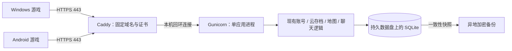

# 公网同服部署方案（已确认）

日期：2026-10-22。用户已确认生产适配与本地验证，默认域名确定为 `if.pikastairs.cc`。公网部署仍等待服务器信息；实际运行材料见 [生产运行手册](../server/multiplayer/deploy/README.md)。

## 1. 推荐部署结构

首版采用一台 Linux 云主机，运行 Caddy、Gunicorn、现有 Python 业务服务和 SQLite，由 systemd 管理启动、退出与故障重启。先完成小规模公网验收，再根据压测确定人数上限。



默认域名为 `if.pikastairs.cc`。建议起步配置为 2 vCPU、4 GB 内存、80 GB SSD；这只是内测起点，尚无公网容量承诺。区域根据主要玩家所在位置选择，已有合适服务器和域名时可以复用。

公网开放 TCP 443，以及证书验证/HTTPS 跳转使用的 TCP 80；SSH 仅允许运维来源。业务后端只监听 `127.0.0.1:8765`。域名 DNS 指向该主机，首版采用直连入口。Caddy 管理公信任证书与续期；证书链需分别通过 Windows 游戏运行库和 Android 系统信任库的实际验证。[Caddy 官方说明](https://caddyserver.com/docs/automatic-https)

当前地图与聊天协议使用 HTTP 请求，不需要额外开放 UDP、WebSocket 或游戏专用公网端口。

单实例是首版明确边界：现有服务持有数据库实例锁，并在初始化时执行在线状态与战斗恢复逻辑。多 worker、多台应用实例、自动滚动重载都需要另外设计，首版不启用。主机故障时会短暂停服，依靠恢复流程恢复服务。

## 2. 上线前需要补齐的代码和配置

以下是已批准实施的范围；实现入口与本地验证范围见生产运行手册：

1. **生产 HTTP 入口。** 保留 `Store.request` 的业务与事务语义，增加薄层 WSGI 适配器交给 Gunicorn。现有 `http.server` 入口继续用于本地测试；Python 官方明确不推荐其用于生产。[Python 文档](https://docs.python.org/3/library/http.server.html)
2. **单实例生命周期。** Gunicorn 使用 1 个应用 worker、有界线程和连接数；初始线程数拟为 4，压测后调整。worker 内创建唯一 Store、持有实例锁，关闭时提交/关闭连接并释放锁。保持 `preload_app=False`，避免把已打开的 SQLite 连接跨 fork 继承。[Gunicorn 配置说明](https://gunicorn.org/reference/settings/)
3. **真实 IP 和登录限流。** 当前认证从 TCP 对端地址限流，直接加反向代理会把所有玩家记成 `127.0.0.1`，共享“60 次/5 分钟”的额度。Caddy 覆写客户端地址头，应用只信任来自本机代理的该头，拒绝客户端伪造；再按真实 IP、账号分别限流。
4. **登录与地图同步互不拖累。** 当前 scrypt 密码计算在业务全局锁中执行。将昂贵的密码运算与地图同步所用的临界区隔离，同时保留注册唯一性和登录校验的原子性；使用有界认证并发，过载明确返回限流结果。
5. **有界请求。** 设置请求头、请求体、读取超时和并发上限。保留当前普通 JSON 请求 512 KiB、云存档上传 2 MiB 的后端限制，代理的总体上限设为 2 MiB 并实际验证边界；Android 大存档继续走现有分片接口。地图/心跳与登录分别设置限流预算，避免误伤正常轮询。[Caddy 请求体限制](https://caddyserver.com/docs/caddyfile/directives/request_body)
6. **持久化与运维。** 增加生产数据库路径与挂载检查、`WAL + synchronous=FULL`、在线备份/恢复工具、服务单元、日志轮转、健康与备份状态检查。生产常规启动发现数据库缺失时应报错；新建空库必须走显式初始化流程，避免挂载错误被误当成全新服务器。

以上改造先在本地/隔离环境运行现有回归，再进入公网验收。

## 3. Windows 和 Android 的连接配置

两端统一填写同一个地址：

```text
https://if.pikastairs.cc
```

地址只填写协议与域名，不加 `/v1`、`/api`、账号密码或尾部路径；端点路径由客户端补全。统一省略默认的 `:443`，避免形成不同的本机服务器配置分区。

| 平台 | 配置步骤 |
| --- | --- |
| Windows | 启动游戏 → 模式选择 → 设置服务器 → 输入上述地址 → 在线模式 → 注册/登录 → 创建或加载角色 |
| Android | 安装带联网模块的 Android.9 或后续版本 → 相同的设置服务器与登录流程；公网使用正常公信任 HTTPS 证书 |

现有两端均可通过菜单修改地址，单纯连接新服务器不必先修改游戏代码。域名确定后，如果需要开箱即用，可以在后续分发包中预置地址，并同步生成两端兼容性清单与服务端可信目录。开发启动脚本/环境变量不要继续强制覆盖为本机测试地址。

同服验证分为两种账号使用方式：

- **两端同时在线、互相看见和聊天：使用两个不同账号。** 游戏版本、数据/Mods 指纹及当前地图必须兼容；仅版本名称相同还不够。
- **同一个角色跨端继续游玩：使用同一个账号，顺序切换设备。** 第一端保存并确认云端同步后退出在线游戏，再在第二端登录。现有单写入租约阻止两个设备同时覆盖一个账号的存档；异常断开时最长通常需等待 120 秒租约到期。

后续服务器换 IP 时保持域名不变，客户端无需改地址。账号与存档仍必须迁移到新服务器，修改 DNS 不会自动搬迁数据库。

## 4. 账号与云存档如何永久保存

将代码、数据、配置和备份分开存放，拟定路径为：

```text
/opt/kif-mmo/releases/<版本>/         只读的服务代码、依赖与可信目录
/opt/kif-mmo/current                 指向当前代码版本
/etc/kif-mmo/                        服务配置、备份配置及受限凭据
/var/lib/kif-mmo/multiplayer.sqlite3 持久数据盘上的主数据库
/var/lib/kif-mmo/backup-staging/     一致性快照暂存，最多保留最新 3 份
```

系统盘重装、代码升级与服务重启都不能删除或重新初始化 `/var/lib/kif-mmo`。采用受限服务账号读写数据目录；数据库不放进 Git、APK、网页静态目录或代码发布包。

| 内容 | 当前存放方式与持久性 |
| --- | --- |
| 账号、角色身份、好友码 | `accounts`、`identities` 等表，重启保留 |
| 密码 | 每账号随机盐和 scrypt 哈希，数据库不保存明文密码 |
| 登录会话 | `account_sessions` 保存令牌哈希和到期时间，目前为 7 天；客户端保存自己的登录凭据 |
| 云存档 | `cloud_saves` 按账号、槽位保存最新文档、修订号和更新时间；目前每账号 8 个手动槽位、2 个自动槽位 |
| 上传去重与恢复记录 | `cloud_uploads`、分片和回执表，与账号、存档一起备份；不能只迁移存档表 |
| 地图玩家在线状态 | 临时状态，重启清空后由客户端重新加入，不影响角色存档 |
| 地图/世界聊天 | SQLite 中有限保留；当前发送时清理约 7 天以前或超出最近 10000 条的记录，不作为永久聊天档案 |
| 交易、收藏等既有功能数据 | 同一个数据库中的相关表，随完整数据库一起备份与迁移 |

SQLite 数据库使用本机持久 SSD 文件系统。其 WAL 日志是运行中数据库状态的一部分，不能当作临时垃圾删除，也不能只复制一个正在运行的 `.sqlite3` 文件来备份。[SQLite WAL 说明](https://www.sqlite.org/wal.html)

当前代码使用 `synchronous=NORMAL`；拟在公网环境改为 `FULL`，加强已提交保存对系统崩溃/断电的耐久性，并实测磁盘延迟。耐久性仍以底层磁盘正确执行同步写入为前提。[SQLite 同步设置](https://www.sqlite.org/pragma.html#pragma_synchronous)

云端写入保留当前事务、修订号 CAS、上传 ID 去重和校验和机制。客户端约每 60 秒在安全游戏状态捕获一次，战斗/剧情等情况可能延后；手动保存与离线待同步记录继续保留。跨端切换应以“已同步到云端”为准。

当前每个云槽位保存最新版本，不等于已经具备任意历史版本回档。首版通过下面的整库快照保留恢复点；若需要玩家自助逐版本回档，再增加单槽位历史版本功能。邮箱找回/密码重置也不是当前已有功能，需要时另列范围。

## 5. 备份、恢复与升级

### 备份策略

- 每 15 分钟通过 SQLite Online Backup API 产生一致性快照，完成后做完整性检查、记录数据库/代码/目录版本与校验值，再加密发送到独立存储位置。备份脚本直接使用 SQLite 连接，不实例化会执行重启恢复的业务 Store。[Python backup API](https://docs.python.org/3/library/sqlite3.html#sqlite3.Connection.backup)
- 本机只保留最新 3 份；异地拟保留近 24 小时的 15 分钟恢复点、近 30 天的每日恢复点、近 6 个月的每月恢复点，最终根据数据量和预算调整。
- 异地备份与业务主机分离；备份凭据与解密密钥不进入客户端。主机/数据盘加密和备份加密分别配置，不能把密码哈希等同于整库存储加密。
- 监控备份生成、异地上传、完整性检查和最近成功时间。每次重要升级前另做快照，定期在隔离目录执行真实恢复演练。
- 目标为：已同步云端的数据在单机磁盘故障后最多回退约 15 分钟，恢复服务目标 1 小时内。两者以备份按时成功和恢复演练达标为前提；尚未上传的客户端进度不包含在该保证中。

上传回执和交易幂等记录首版保留并监控增长，不能为腾空间直接清空。后续清理必须先定义离线重放窗口和过期恢复行为。

### 故障恢复

暂停写入 → 保留故障现场 → 选择并校验一致性备份 → 在正确持久目录恢复完整数据库与匹配代码/可信目录 → 处理失效会话及写租约 → 启动并检查 → 两端重新登录验证。

数据库回档可能与客户端较新的待上传记录冲突。恢复时保留这些本机记录，按账号核对，不让旧缓存自动覆盖恢复点。单个玩家回档不能直接替换整库导致其他玩家一起回退。

### 发布与回滚

每次发布固定代码版本、依赖版本和可信目录，先备份，再停旧实例、切代码、做明确的数据库迁移后启动，避免两个 Store 重叠初始化。客户端涉及脚本/数据更新时同步发布两端兼容版本。

应用回滚优先回滚兼容的代码。若数据库结构已改变，必须使用经过验证的兼容迁移或匹配备份，不能盲目降级。阶段提交继续沿用现有特性分支工作方式。

## 6. 确认后的实施阶段与验收

1. **生产适配阶段：** WSGI/Gunicorn 入口、代理 IP、认证有界并发、数据路径守卫与 FULL 同步模式；运行现有 157 项服务测试并补充相应回归。
2. **运维材料阶段：** Caddy/systemd 配置、初始化/更新/备份/恢复脚本、监控检查和回滚说明；先在隔离环境验证。
3. **公网部署阶段：** 在选定主机配置域名、证书、持久盘和异地备份，先开放小范围验证。
4. **公网双端验收阶段：** Windows 与 Android 从正常互联网连接同一 HTTPS 域名，尽量分别使用家庭网络和蜂窝网络。验证注册登录、同图互见、双频道聊天、切图隔离、手动/定时保存、双向恢复、重复登录冲突、断网重连、服务重启和从备份恢复。
5. **容量与放量阶段：** 先以约 20 个同时在线客户端为压测目标，同时施加登录流量，检查地图同步、认证、云保存延迟、CPU、内存、磁盘与备份耗时。达标后才给出对外人数上限。

健康检查只用于服务存活/就绪，不作为全部功能正常的证明。日志记录路径、状态码、耗时与必要错误，排除密码、令牌、请求体及完整存档；运维告警覆盖 5xx、持续延迟、磁盘不足、备份失败和证书续期异常。

## 7. 需要确认的部署参数

实际部署前补充：是否复用已有 Linux 服务器及其配置、主要玩家地区与预计同时在线人数、异地备份存放位置/预算。域名已确定为 `if.pikastairs.cc`。正式环境默认使用新的生产数据库；此前联测账号库保持隔离。若希望保留联测账号和角色，需要明确指定来源库并作为迁移步骤处理。

本阶段只实现生产适配、部署/备份恢复脚本并在本地验证。购买资源、修改 DNS/安全组、连接服务器或启动公网服务，均等待用户提供服务器信息后进行。
